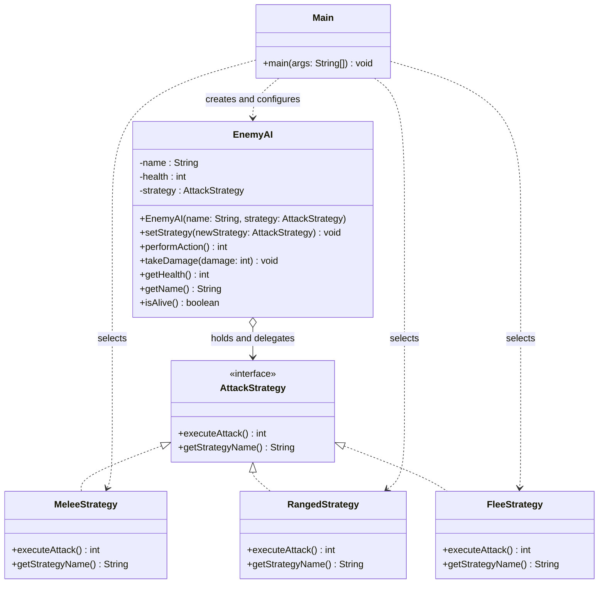

# Assignment #5 — Strategy Pattern

**Project:** Game AI Battle Simulator  
**Course:** Software Design Patterns (ShP-2216)  
**Student:** Arkat Toktar  
**University:** Astana IT University  
**Language:** Java (JDK 17)

## 1. Introduction

My project is a console-based **Game AI Battle Simulator**. It demonstrates the Strategy behavioral design pattern through interchangeable enemy actions. The family of algorithms consists of **MeleeStrategy** (a sword attack dealing 25 damage), **RangedStrategy** (an arrow attack dealing 15 damage), and **FleeStrategy** (an escape attempt dealing no damage).

All three strategies implement the `AttackStrategy` interface. The `EnemyAI` class acts as the context: it holds the currently selected strategy and delegates its execution through `executeAttack()`. The `Main` class acts as the client: the user chooses a strategy from the menu, and `Main` passes the selected implementation to `EnemyAI` using `setStrategy()`. The strategy can change between rounds without changing the context's implementation. This is a demonstration of strategy switching, not autonomous decision-making by the enemy.

## 2. UML Class Diagram



`AttackStrategy` is the common contract. The three concrete classes implement it. `EnemyAI` depends on the interface rather than any concrete strategy, while `Main` selects and changes the strategy at runtime.

## 3. Clean Code Principles

### 3.1 Replace branching with polymorphism

**Before (hypothetical design without Strategy):**

```java
if (attackType.equals("MELEE")) {
    damage = 25;
} else if (attackType.equals("RANGED")) {
    damage = 15;
} else {
    damage = 0;
}
```

**After (in `EnemyAI`):**

```java
int damage = strategy.executeAttack();
```

The context no longer checks strategy types. Each concrete strategy provides its own behavior. The `switch` in `Main` only interprets the user's menu choice; it does not implement attack algorithms inside the context.

### 3.2 Meaningful names

**Before (hypothetical):**

```java
class A { int run() { return 25; } }
```

**After:**

```java
public class MeleeStrategy implements AttackStrategy {
    @Override
    public int executeAttack() {
        System.out.println("Enemy attacks with a sword!");
        return 25;
    }
    @Override
    public String getStrategyName() {
        return "Melee Attack";
    }
}
```

Names such as `MeleeStrategy`, `executeAttack`, and `setStrategy` reveal each class's and method's purpose.

### 3.3 Single Responsibility Principle

**Before (hypothetical):** A single `EnemyAI` class calculates melee damage, ranged damage, escape behavior, and enemy health.

**After:** Each concrete strategy is responsible for one action. For example, `RangedStrategy.executeAttack()` prints the ranged action and returns 15 damage. `EnemyAI` manages the enemy and delegates its action rather than implementing every attack algorithm.

```java
public int performAction() {
    System.out.println("\n" + name + "'s turn!");
    int damage = strategy.executeAttack();
    System.out.println("Damage: " + damage);
    return damage;
}
```

### 3.4 Program to an interface, not an implementation

**Before (hypothetical):**

```java
private MeleeStrategy strategy;
```

**After (in `EnemyAI`):**

```java
private AttackStrategy strategy;

public void setStrategy(AttackStrategy newStrategy) {
    this.strategy = Objects.requireNonNull(newStrategy);
}
```

The context depends on the `AttackStrategy` abstraction. It can accept any implementation of that interface, and the null check prevents an invalid strategy reference.

### 3.5 Open/Closed Principle and extensibility

**Before (hypothetical):** Adding a new attack requires editing a conditional chain inside `EnemyAI`.

**After:** A new strategy can implement the existing interface without modifying `EnemyAI`:

```java
// Example only: optional future extension, not in the current project.
public class MagicStrategy implements AttackStrategy {
    @Override
    public int executeAttack() {
        return 35;
    }

    @Override
    public String getStrategyName() {
        return "Magic Attack";
    }
}
```

The client would still need to expose the new choice in its menu, but the context and existing strategies would remain unchanged.

## 4. Strategy vs. State

Strategy and State both use composition and interchangeable objects, but their intent is different. **Strategy** allows a client to select one of several algorithms for the same task. **State** models an object's internal states and changes its behavior as those states transition, often as a consequence of events. In my simulator, `Main` explicitly selects a melee, ranged, or flee algorithm and passes it to `EnemyAI`. The context does not automatically transition between states. Therefore, **Strategy** better describes the current design. The enemy's health is game data, not a State-pattern object.

## 5. Conclusion

The Strategy pattern made the battle simulator easier to extend and understand. Instead of placing all attack logic inside `EnemyAI`, each behavior has its own class, and the context calls the shared interface. I can switch strategies during a running battle without rebuilding the enemy object. The trade-off is that even a small simulator needs several Java classes and an interface. For this project, that extra structure is worthwhile because it makes the behaviors clearer and allows future strategies to be added with minimal changes to existing code.

## 6. GitHub Repository

**Repository URL:** [INSERT YOUR GITHUB REPOSITORY URL HERE]

The repository should contain the Java source files, a `README.md` with build/run instructions and instructions for adding a strategy, and an incremental commit history.

---

**Reference:** Course assignment brief, *Assignment #5 — Strategy Pattern*, Astana IT University (2026–2027). This report should be reviewed and revised to reflect the student's own implementation and understanding, in accordance with the assignment's academic integrity requirements.
